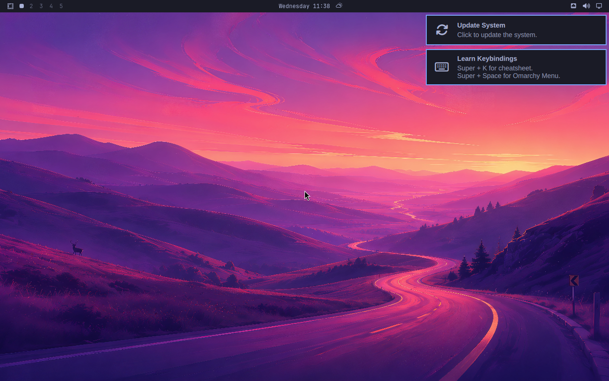
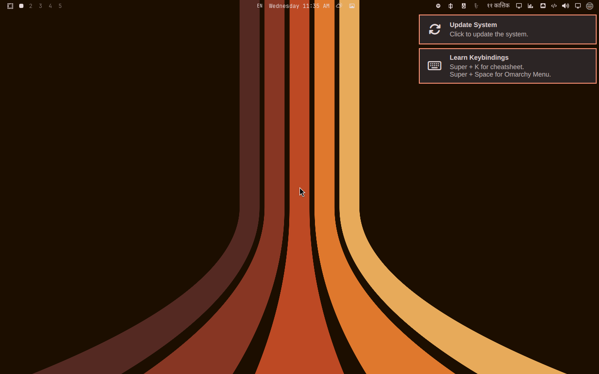

# OmaPhoenix


**Reinstall Omarchy and get your whole setup back with one command.** OmaPhoenix snapshots your packages, AUR packages, plugins, themes, config, `/etc`, services and (encrypted, if you opt in) SSH keys into a private GitHub repo you own. Every snapshot is security-audited first, so leaked tokens and risky files stay off your next machine.

[](https://github.com/sumdahl/omaphoenix/actions/workflows/ci.yml)
[](https://github.com/sumdahl/omaphoenix/releases)

> **v0.1.0, early.** Tested by full restores on a fresh Omarchy 4.0.6 VM before every release (below), but so far against one person's setup. Expect rough edges on yours, and please [report them](https://github.com/sumdahl/omaphoenix/issues/new/choose).

| Fresh Omarchy 4.0.6 | After `omaphoenix restore` |
|---|---|
|  |  |

**Security Audit by [Manish Karki](https://github.com/mnshchtri).** The audit engine, its 13 sections and the audit's terminal app are his design, ported to Rust from [mnshchtri/secaudit](https://github.com/mnshchtri/secaudit).

## Install

```sh
curl -fsSL https://raw.githubusercontent.com/sumdahl/omaphoenix/v0.1.0/install.sh | bash
```

The installer checks the download against the release's `SHA256SUMS` and refuses a mismatch, installs `omaphoenix` to `~/.local/bin`, and then offers to:

- **back up this machine:** creates a private repo on *your* GitHub (`<you>/omaphoenix-backup`), asks about SSH keys, takes the first snapshot and sets a schedule; or
- **restore a snapshot:** shows a dry run first, then asks before applying.

Options go after `| bash -s --`: `--sysctl` (Manish's kernel hardening drop-in), `--uninstall`. `OMAPHOENIX_VERSION=v0.1.0` pins a release.

## Use it

```sh
omaphoenix                       # the terminal app: Pulse, Timeline, Audit, Backup, Migrate, Settings
omaphoenix select                # choose what is backed up; nothing is, until you choose
omaphoenix snapshot              # capture now
omaphoenix timer on 1h           # automatic: 15m, 30m, 1h, 6h, daily, and after every `omarchy update`; `timer off` = manual
omaphoenix restore --dry-run     # what a restore would change, changing nothing
omaphoenix restore --only theme,plugin       # some categories
omaphoenix restore '.config/hypr' --at 2026-10-20   # one folder from an older snapshot
omaphoenix undo                  # reverse the last restore
omaphoenix doctor                # what a reinstall would lose right now
omaphoenix audit                 # the security report (sudo for full coverage); `audit tui` to browse it
```

**New laptop:** install, choose restore, or `omaphoenix restore --from https://github.com/<you>/omaphoenix-backup.git --dry-run`, then without `--dry-run`.

## How we know it works

- **A full restore on a fresh Omarchy VM before each release** ([docs/14](docs/14-vm-restore-test.md), `scripts/vm`). The v0.1.0 run, onto a clean Omarchy 4.0.6 install from a real daily-driver snapshot:

  ```
  ✓ pkg-repo  applied 53 · already present 168
  ✓ pkg-aur   applied 14 · already present 0
  ✓ plugin    applied 41 · already present 0
  ✓ theme     applied 57 · already present 0
  ✓ config    applied 1432 · already present 30
  ✓ local     applied 147 · already present 1
  ✓ bin       applied 20 · already present 3
  ✗ pkg-other applied 12 · already present 12
      ✗ npm:@pencil.dev/cli: exit status 1
  ✓ etc       applied 19 · already present 13
  ✓ service   applied 1 · already present 50
  restore took 54 min · peak memory 8.6 MB
  ```

  The one failure is an upstream bug (`@pencil.dev/cli`'s `sharp` dependency doesn't build on Node 25); the restore kept going and listed it, as it does for any package that fails to build.
- **Every bug we found is written up** ([docs/findings](docs/findings/README.md)): how to reproduce it, the cause, the fix and the test that fails without the fix. Most were found by the VM test before anyone hit them.
- **CI on every change:** clippy with warnings as errors, unit and real-terminal tests, `cargo deny` (advisories and licenses), and memory budgets ([RUST.md](RUST.md)).
- **Checked against the versions it replaces:** the Rust audit gives the same findings as Manish's Bash engine (`scripts/audit-parity`), and snapshots match the earlier Go OmaPhoenix byte for byte (`scripts/omaphoenix-parity`).

## What it won't restore

Said up front, so a gap doesn't look like a bug:

- **Anything you didn't select,** and secrets unless you opted in (`omaphoenix secrets init`).
- **Files that look like they hold a secret** (tokens, keys in config files): the audit leaves them out of the snapshot and lists them.
- **Browser and app profiles** (Brave, Chromium, Code, Signal, …): caches and sessions, not config.
- **Files over 5 MB** (large wallpapers, for example).
- **Hardware-specific settings onto different hardware** (monitor layout, input): skipped unless you name them or pass `--all-hardware`.
- **Things built from local folders** (a binary symlinked into a project you build yourself): listed with "reinstall manually".
- **Packages that fail to build on the new machine** (an AUR package or an npm tool that breaks on a newer compiler or Node): the restore keeps going and lists each one at the end.

## Is it safe?

- **Your snapshots go only to your own private GitHub repo.** OmaPhoenix has no server and sends nothing anywhere else.
- **SSH keys are encrypted** with [age](https://age-encryption.org) and a passphrase only you know, before they leave the machine.
- **The audit only reads**; a fix runs only when you pick it and confirm the exact command.
- **Restores can be undone**: replaced files are kept, and `omaphoenix undo` puts them back.
- **Verify a download came from this repo's release workflow:**

  ```sh
  gh attestation verify omaphoenix_linux_amd64.tar.gz -R sumdahl/omaphoenix
  ```

Found a security problem? See [SECURITY.md](SECURITY.md); please don't open a public issue for it.

## Build from source

```sh
cargo build --release -p omaphoenix    # target/release/omaphoenix
```

Rust 1.95 (`rust-toolchain.toml`). How the codebase is held together: [RUST.md](RUST.md) (engineering standards), [DESIGN.md](DESIGN.md) (UI and UX), [AGENTS.md](AGENTS.md) (rules for AI agents working here). The project's history and design documents are in [docs/project.md](docs/project.md).

## License

MIT OR Apache-2.0, at your option ([LICENSE-MIT](LICENSE-MIT), [LICENSE-APACHE](LICENSE-APACHE)).
